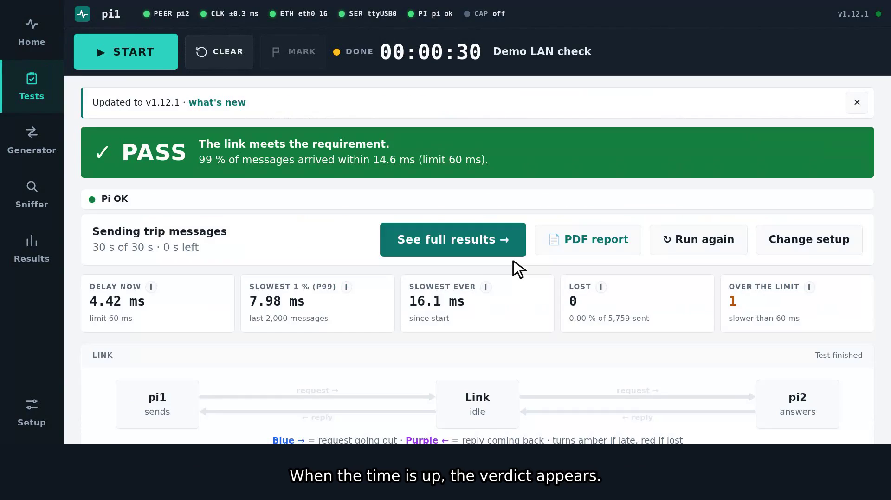
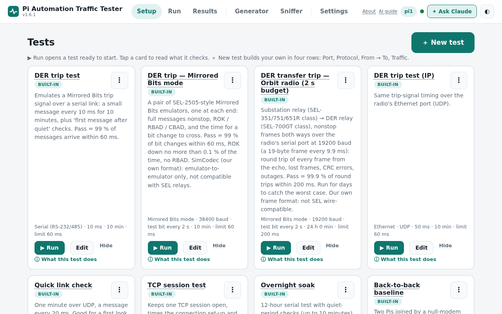

# Pi Automation Traffic Tester

**Turn two or more Raspberry Pi 5s into a network and serial-link tester**: measure round-trip delay, jitter and message loss over serial, Ethernet or radio links (for example a 5G/FirstNet trip-signal path with a 60 ms target), generate traffic, and capture/sniff it, all from a web page on your phone or laptop.

## Demo video

[](docs/demo/traffic-tester-demo.mp4)

**[Watch the demo (5 min, voice-over + captions)](docs/demo/traffic-tester-demo.mp4)**: set up a test, run it, read the verdict, compare two runs and capture packets, on two real Pis. Captions: [traffic-tester-demo.srt](docs/demo/traffic-tester-demo.srt). Network addresses and other identifiers in the recording are blurred.




## What you need

- **2 or more Raspberry Pi 5** (one per end of the link), each with the official **5 V / 5 A USB-C power supply**
- A **microSD card (32 GB+) or SSD** per Pi
- For serial tests: **USB-serial adapters** (FTDI) and a **null-modem cable** (or the radios' own cables)
- A **phone or laptop** with a browser
- Internet for the install (one time), unless you use the offline package

## Install in 3 steps

> Full, click-by-click guide for beginners: **[INSTALL.md](INSTALL.md)**.

1. **Get a card ready.** Easiest: flash the ready-made image (`.img.xz` from Releases) with *Raspberry Pi Imager* → *Use custom*. Otherwise flash *Raspberry Pi OS (64-bit)* with SSH turned on.
2. **If you flashed plain Raspberry Pi OS**, log in to the Pi (`ssh <user>@<pi-name>.local`) and run:
   ```
   sudo apt update && sudo apt install -y git
   git clone https://github.com/TedCracker/pi-automation-traffic-tester.git
   cd pi-automation-traffic-tester && sudo bash scripts/install-pi.sh
   ```
   (With the ready-made image there is nothing to run.)
3. **Repeat for every Pi**, each with its own name (`pi1`, `pi2`, ...).

No internet at the site? Use the **offline package**: [docs/INSTALL-OFFLINE.md](docs/INSTALL-OFFLINE.md).

## Open the app

- Join the Pi's own Wi-Fi hotspot: the name is the Pi's name (`pi-setup` on a brand-new image card), password **`password`**. Then open **http://10.42.0.1:8080**.
- Or open **http://\<pi-name\>.local:8080** from any device on the same network as the Pi's Ethernet cable.
- A brand-new image card shows **"Set up this Pi"** first: type a name (`pi1`) and tap **Name this Pi**.
- **Change the default Wi-Fi password** in **Settings → Network**, and set a web password in **Settings → Web password** if others share the network.

## Run your first test

1. Install the second Pi with another name; they find each other automatically.
2. Open **Tests** and press **▶ Run** on **Quick link check**.
3. Choose the other Pi and press **Start**.
4. Watch the live chart on the **Run** page.
5. Read the pass/fail verdict; every run is kept under **Results** (export JSON/CSV or a PDF report).

For a serial link, connect the two Pis with a null-modem cable and start with **Back-to-back baseline**: it shows how much delay the Pis and adapters add themselves.

## Update

**Download the newest code** (green **Code** button → **Download ZIP**, or `git pull` in your clone), copy it to the Pi and run `sudo bash scripts/install-pi.sh` again; your tests and results are kept. The in-app **Check for updates** button needs the original maintainer's private update channel, so it does **not** work on a copy you installed from this public page; use the steps above (or a `.ptt` file if the maintainer gave you one). Details in [INSTALL.md](INSTALL.md#update).

## Help

- **Troubleshooting:** [INSTALL.md → Common problems](INSTALL.md#common-problems) and [docs/INSTALL-PI.md](docs/INSTALL-PI.md) (power, serial ports, sniffer wiring).
- **In the app:** the **AI guide** link (top right) explains the current screen. Any AI assistant can read it to help you.
- **Bugs and questions:** open an *Issue* on the GitHub page of this project.

## More documentation

| Topic | Where |
|---|---|
| All guides, indexed | [docs/README.md](docs/README.md) |
| What's new in each version | [CHANGELOG.md](CHANGELOG.md) |
| Features, spec items, long technical notes | [docs/DETAILS.md](docs/DETAILS.md) |
| Formal spec and architecture | [docs/SPEC.md](docs/SPEC.md) |
| Hardware, cabling, serial ports, sniffer | [docs/INSTALL-PI.md](docs/INSTALL-PI.md) |

## For developers

```
python3 -m venv venv && venv/bin/pip install -r requirements-dev.txt
venv/bin/python -m pytest tests -q        # unit tests
```
Layout: `traffic_tester/` the app (Python + browser UI), `scripts/` installer, packaging and end-to-end scripts, `tests/`, `docs/`. Build and update scripts: `scripts/pkg/build-image.sh` (SD image), `scripts/publish-update.sh` (signed update bundle).

*No licence file is included yet.*
